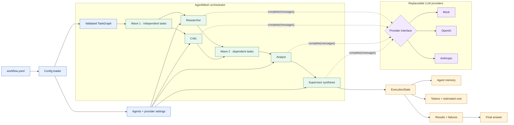

# AgentMesh: Multi-Agent Orchestration as a Task Graph

## Publication diagram

**Suggested caption:** AgentMesh turns a multi-agent workflow into a validated dependency graph. Independent tasks run in waves, dependent tasks wait for their inputs, providers remain replaceable, and every outcome is captured in execution state before supervisor synthesis.

**Alt text:** A YAML workflow is loaded into an AgentMesh task graph and a set of agents. Independent researcher and critic tasks run in the first wave, an analyst runs after their results are available, and a supervisor synthesizes the output. Agents use a replaceable provider interface supporting mock, OpenAI, and Anthropic providers. Execution state records results, failures, memory, token usage, and estimated cost.

---

## Substack draft

### Multi-Agent Systems Need a Graph, Not a Group Chat

Many multi-agent demos are structurally simple: give several agents names, call an LLM repeatedly, and pass text from one prompt to the next.

That can produce an impressive demo. It does not automatically produce a system that is easy to test, inspect, or extend.

[AgentMesh](https://github.com/codesanthan/agentmesh) starts from a more useful abstraction: a multi-agent workflow is a dependency graph.

Each task has an owner, a prompt, and—when necessary—explicit dependencies. Before execution, the graph checks for missing dependencies and cycles. During execution, it groups tasks into waves. Independent tasks can run together; dependent tasks wait until their inputs are available.

That gives AgentMesh three straightforward execution strategies:

1. **Sequential** — run one task at a time in dependency order.
2. **Parallel** — run the independent tasks in each wave concurrently.
3. **Supervisor** — execute the graph and ask a designated agent to synthesize the completed results.

The interesting part is not the number of agents. It is the explicit structure between them.

An agent pairs a system prompt with an LLM provider and maintains its own conversation history. The provider sits behind a small interface, keeping orchestration separate from the model vendor. AgentMesh includes mock, OpenAI, and Anthropic providers, and individual agents can use different provider configurations inside the same workflow.

That makes mixed-model workflows possible. A lower-cost model might handle classification or triage, while a stronger model performs final synthesis. The graph does not need to change when the provider does.

AgentMesh also treats execution results as state rather than disposable text. Every task produces a recorded result, including failures. Successful results can include token usage and estimated cost, with totals available for the full run or grouped by agent.

This matters because failure is part of orchestration. If one task fails, the entire run should not disappear into an exception with no record of what succeeded. A visible execution state creates a foundation for debugging, evaluation, and eventually recovery.

The mock provider deserves special attention. It lets the test suite, CI pipeline, and example workflows run deterministically without API keys. That is a small feature with a large architectural consequence: orchestration behavior can be tested independently from model behavior.

AgentMesh is deliberately compact. Its runtime dependency is PyYAML, and workflows can be defined in YAML or assembled directly in Python. The repository includes runnable research, customer-support, and trading-research examples.

It is also early. Async provider support, streaming, retry and backoff policies, and persistent resumable execution are listed on the roadmap. Those capabilities will matter for higher-throughput and production workloads.

Still, the core design is already clear:

- tasks should have explicit dependencies;
- concurrency should follow the graph;
- providers should remain replaceable;
- failures and usage should remain visible;
- synthesis should be a defined step, not an accidental final prompt.

The future of multi-agent software probably looks less like a group chat and more like a small distributed system. AgentMesh is an attempt to build exactly that—without turning the framework itself into the biggest part of the application.

Explore the project: https://github.com/codesanthan/agentmesh

---

## LinkedIn draft

I thought building an AI orchestration framework would teach me about AI.

Instead, it reminded me why software engineering fundamentals matter more than ever.

When I started AgentMesh, I expected prompts and models to consume most of my attention. The harder—and more consequential—questions turned out to be different:

How should work be coordinated?

How do we test orchestration without depending on an external model?

How do we make failures visible when an AI response looks plausible but is still wrong?

How do we change providers without redesigning the system around them?

One decision captures that learning particularly well.

I introduced a provider interface because I wanted vendor flexibility. The more valuable result was something I had not fully anticipated: it made a deterministic mock provider possible.

That meant workflows could be tested without API keys. Examples could run without spending money. CI could validate orchestration without nondeterministic model responses. New contributors could understand the system immediately.

I thought I was designing for flexibility.

I was actually designing for developer experience.

The same pattern appeared elsewhere:

→ Explicit task dependencies made parallel execution understandable.  
→ A validated graph exposed missing inputs and cycles before model calls consumed time and money.  
→ Recorded execution state kept results, failures, memory, token usage, and estimated cost inspectable.  
→ A separate provider layer kept orchestration independent of whichever model happened to be doing the work.

None of this is glamorous. That is precisely the point.

As AI systems move from experiments into operating environments, technical leadership is less about chasing every new model and more about choosing the foundations that let teams change safely.

The technology changed.

The engineering principles did not.

I wrote more about what building AgentMesh taught me—and the assumptions I got wrong—in my latest article.

📖 **Read the full story on Curiosity Ledger:**  
https://curiosityledger.substack.com

💻 **Explore the AgentMesh architecture and source code:**  
https://github.com/codesanthan/agentmesh

What “boring” engineering capability has created the most leverage in your AI work?

#AIEngineering #AgenticAI #SoftwareArchitecture #EngineeringLeadership #OpenSource

---

## Publishing notes

- Export the diagram as SVG for Substack.
- Export a 1200×627 PNG for LinkedIn.
- Use the caption with the Substack version and the alt text on both platforms.
- Attach the diagram directly to the LinkedIn post so the opening hook stays above “see more.”
