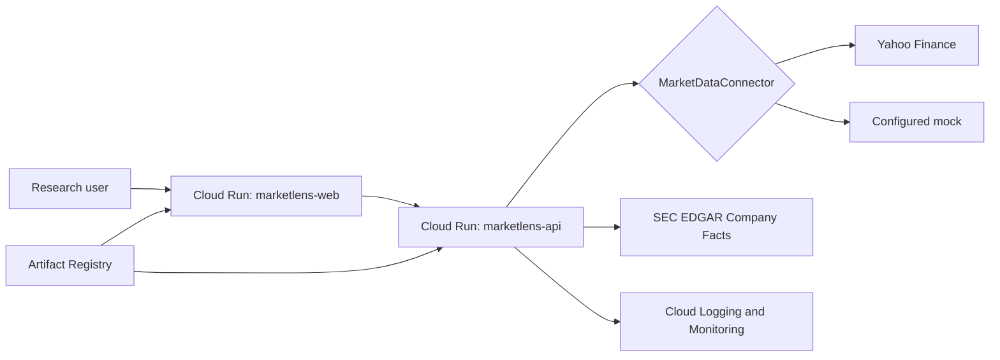

# Architecture

The independently deployable web app only consumes normalized API responses. FastAPI validates ticker
symbol format (1-5 letters plus an optional class suffix) and chooses one connector at startup. Connector-specific mapping, retry,
timeout, caching, and error handling remain outside routes. This seam supports future SEC, FRED,
FMP, and Unusual Whales connectors without changing the UI contract. The SEC connector independently
normalizes public XBRL Company Facts and does not depend on the selected market connector. There is no
database, queue, authentication system, or distributed cache in Milestone 1.
