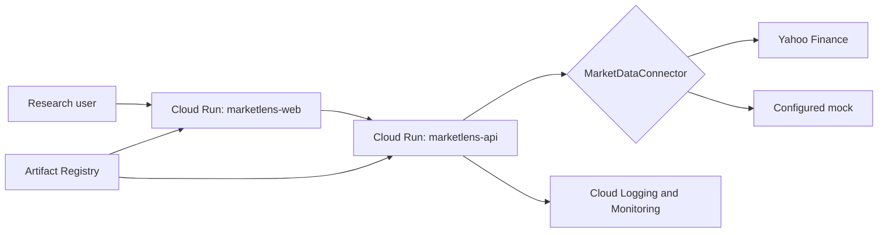

# Architecture

The independently deployable web app only consumes normalized API responses. FastAPI validates the
eight-symbol allowlist and chooses one connector at startup. Connector-specific mapping, retry,
timeout, caching, and error handling remain outside routes. This seam supports future SEC, FRED,
FMP, and Unusual Whales connectors without changing the UI contract. There is deliberately no
database, queue, authentication system, or distributed cache in Milestone 1.

